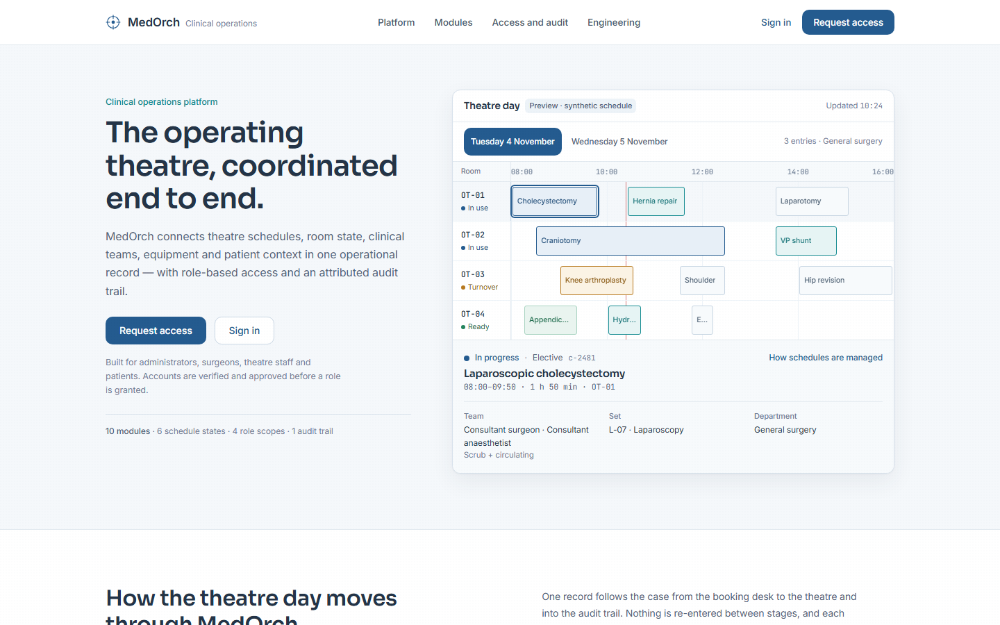
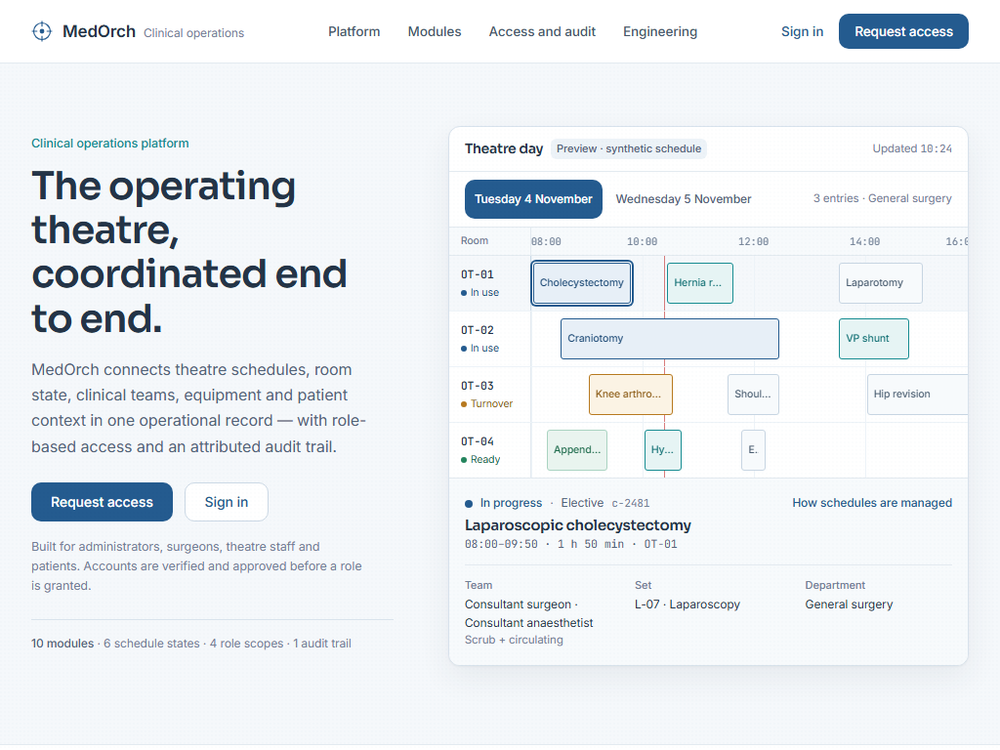
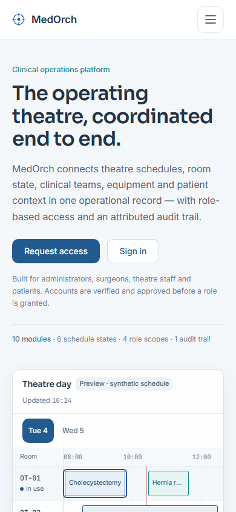

# Stage 2 — Production Test Report

## Environment

| Item | Value |
| --- | --- |
| Application | MedOrch |
| Node | 22.13.1 |
| npm | 10.9.2 |
| Next.js | 16.3.6 |
| Build | Existing successful production build, `BUILD_ID=AaX5xWTUUnzpcGvBNJKII` |
| Server | `next start` on `http://localhost:5274` (`NODE_ENV=production`) |
| Browser | Playwright Chromium |
| Viewports | 1440×900, 1024×768, 390×844 (touch enabled at 390) |
| Database | Local `medorch-postgres` (Postgres 17, existing volume), healthy |
| Session | Real Auth.js credentials sign-in against the seeded accounts |

The verification script ran in a temporary file and was removed after the run. Passwords were supplied through process environment variables and are not present in this report or the evidence files.

## Result

**37/37 checks passed.**

- Browser console `error` messages: **2**
- Page errors: **0**
- Captured network events: **119**
  - **117** aborted Next.js RSC prefetch requests (`net::ERR_ABORTED`), caused by navigating away from links while prefetch was in flight. These are browser-cancelled prefetches, not failed page loads.
  - **2** genuine HTTP 404 responses for `http://localhost:5274/alerts?_rsc=…`.
- Unexpected network failures: **0**

The two 404s are a pre-existing Dashboard defect: `HospitalIntelligence` links to `/alerts`, but no `/alerts` page route exists. Next.js prefetches that link and logs a 404. It is outside Stage 2 scope and was not modified. The landing page itself produced no console errors.

Raw evidence:

- `evidence/browser-run.log` — console output of the final run
- `evidence/browser-checks.json` — all 37 checks plus console and network events
- `evidence/http-endpoints.txt` — production endpoint statuses

## Checks executed

### Landing and production integration — 11/11

| Check | Result |
| --- | --- |
| `/` returns 200 | Pass |
| Approved H1 renders: “The operating theatre, coordinated end to end.” | Pass |
| Preview-only direction note absent | Pass |
| No horizontal overflow at 1440 | Pass — 1440/1440 |
| Logo `/`, Sign in `/login`, Request access `/register` | Pass |
| No `/design-system` links in production footer | Pass |
| Desktop “Platform” navigation reaches `#platform` | Pass |
| OT-03 knee case selection updates the detail panel | Pass — Total knee arthroplasty, 09:00–10:35 · 1 h 35 min · OT-03 |
| Wednesday switches the theatre day | Pass — 2 entries · General surgery; Wednesday cases rendered |
| Schedules module expands with Enter | Pass — `aria-expanded=true`, overlap checks visible |
| Doctor role switch updates scope and audit | Pass — `aria-pressed=true`, “Highlighting 1 action by Doctor” |

### 1024×768 — 3/3

| Check | Result |
| --- | --- |
| `/` returns 200 | Pass |
| No horizontal overflow | Pass — 1024/1024 |
| Desktop header navigation visible at the `lg` breakpoint | Pass |

### 390×844 touch — 6/6

| Check | Result |
| --- | --- |
| `/` returns 200 | Pass |
| No horizontal overflow | Pass — 390/390 |
| Mobile menu opens, Escape closes it, focus returns to trigger | Pass |
| Tap selects the OT-03 knee case | Pass |
| Tap switches to Wednesday | Pass |
| Tap switches role scope to OT staff | Pass |

### Authentication and authorization — 17/17

| Check | Result |
| --- | --- |
| Signed-out `/dashboard` lands on `/login` | Pass |
| Signed-out `GET /api/users` | Pass — 401 |
| Login form renders email and password fields | Pass |
| Seeded admin credentials create a session | Pass — role `ADMIN` |
| Admin reaches `/dashboard` | Pass |
| Admin dashboard renders “Hospital operations” | Pass |
| Admin opens `/users` | Pass — 200 |
| Admin `GET /api/users` | Pass — 200 |
| Admin opens `/audit` | Pass — 200 |
| Admin sign-out clears the session cookie and session | Pass — cookie cleared, `/api/auth/session` null |
| Register form renders name and confirm-password fields | Pass |
| Seeded doctor credentials create a session | Pass — role `DOCTOR` |
| Doctor dashboard renders “Day plan” | Pass |
| Doctor opens ADMIN-only `/users` | Pass — redirected to `/unauthorized` |
| Doctor `GET /api/users` | Pass — 403 |
| Doctor opens role-permitted `/schedules` | Pass — Schedules heading visible |
| Doctor sign-out clears the session cookie and session | Pass — cookie cleared, `/api/auth/session` null |

## Screenshots

All screenshots are actual Chromium captures from the production server.

### Landing

Full-page captures: `screenshots/landing-full-1440.png`, `screenshots/landing-full-390.png`.

### Preview and interactions

| Screenshot | State |
| --- | --- |
| `screenshots/preview-ot03-1440.png` | Tuesday, OT-03 knee case selected |
| `screenshots/preview-wed-1440.png` | Wednesday, 2 entries in OT-01 |
| `screenshots/modules-schedules-1440.png` | Schedules module expanded from the keyboard |
| `screenshots/access-doctor-1440.png` | Doctor role selected, audit highlight visible |
| `screenshots/menu-390.png` | Mobile navigation open |
| `screenshots/preview-ot03-390.png` | Touch case selection |
| `screenshots/preview-wed-390.png` | Touch day switch |
| `screenshots/access-ot-390.png` | OT staff role selected by tap |

### Authentication

| Screenshot | State |
| --- | --- |
| `screenshots/signed-out-dashboard-1440.png` | Signed-out dashboard redirected to login |
| `screenshots/login-1440.png` | Login form |
| `screenshots/dashboard-admin-1440.png` | Admin “Hospital operations” dashboard |
| `screenshots/dashboard-doctor-1440.png` | Doctor “Day plan” dashboard |
| `screenshots/users-admin-1440.png` | Admin-only Users page |
| `screenshots/unauthorized-doctor-1440.png` | Doctor denied `/users` |

## Build and static checks

| Command | Result | Evidence |
| --- | --- | --- |
| `npx tsc --noEmit` | Exit 0 | `evidence/typecheck.txt` |
| `npm run lint` | Exit 0, 20 pre-existing warnings | `evidence/lint.txt` |
| `npm run build` | Exit 0 | `evidence/build.txt` |

`/` and `/design-system/clinical` are both prerendered static in the build output. Dashboard and auth routes remain dynamic.

## Blockers encountered and resolved

1. **Interrupted session left an incomplete verification script.** The 128-line temporary script ended mid-statement and was replaced with a complete one, then removed after the run.
2. **Postgres was not running.** The first real sign-in attempt failed with an Auth.js `CallbackRouteError`, whose cause was a `pg-pool` `AggregateError` during `startTransaction`. Docker Desktop and the existing `medorch-postgres` container were started; no reseed or migration was run. Sign-in then worked normally.
3. **Test timing, not application defects.** Early runs had selector mismatches (“1 h 35 min”, Schedules is module 03), RSC prefetch aborts, sign-out polling races, and a shared browser context that made doctor checks flaky. The final run uses separate admin and doctor contexts, waits for the sign-out POST and cookie removal, and waits for dashboard loading states to finish. All 37 checks pass.

## Limitations

- Browser coverage is Chromium only; Firefox and Safari were not run.
- No screen-reader or automated accessibility audit was performed in Stage 2.
- The `/alerts` 404 prefetch is reported but not fixed because it is pre-existing Dashboard behaviour outside the allowed scope.
- Screenshots are viewport captures unless named `landing-full-*`.
