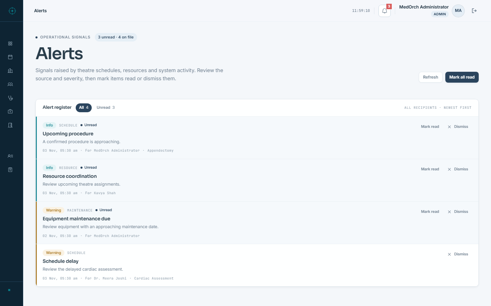
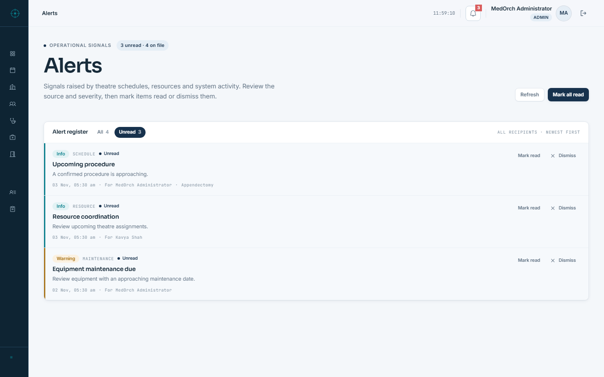
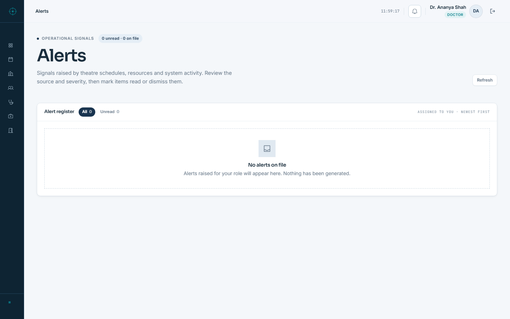

# Stage 3A — Alerts Route Integrity

## Outcome

The `/alerts` 404 was caused by a missing page, not by a wrong link. The dashboard’s “Respond” and “All alerts” links were already correct for a full alert workspace, but no `/alerts` route existed. The alerts domain itself was implemented: a Prisma model, scoped service and repository, four API routes, a header alert drawer and dashboard summaries.

A real authenticated `/alerts` page now renders the existing alert data and reuses the existing read, mark-all-read and dismiss endpoints. No API, service, repository, Prisma model, permission rule or schema was changed.

Mutation verification was completed after provisional acceptance using disposable accounts and records. Mark-read, mark-all-read and dismiss matched the UI and database; cross-user and signed-out requests were rejected; a simulated failed mutation left the row unread and surfaced an actionable error. See `MUTATION_VERIFICATION.md`.

## Route trace summary

Full detail is in `ROUTE_TRACE.md`.

| Reference | Finding |
| --- | --- |
| `src/components/dashboard/HospitalIntelligence.tsx:354` | “Respond” link to `/alerts` from the critical-alert ribbon |
| `src/components/dashboard/HospitalIntelligence.tsx:540` | “All alerts” link to `/alerts` from “Needs a decision” |
| `src/components/layout/Header.tsx` | Renders the existing `AlertCenter` drawer; this is not a route |
| `src/components/alerts/AlertCenter.tsx` | Existing drawer using `/api/alerts` |
| `src/app/api/alerts/**` | Existing list/create/read/delete endpoints |
| `src/modules/alerts/*` | Existing scoped service, repository and validation |
| `prisma/schema.prisma` | Existing `Alert` model and enums |
| `src/lib/auth/permission.ts` | `alerts:read` is granted to all four roles |
| `src/app/alerts/page.tsx` | Did not exist before this stage |

No alerts page route existed elsewhere, no redirect pointed to `/alerts`, and Git history contained no deleted `src/app/alerts` page. The links were correct; the destination was absent.

## Implementation

### Server route

`src/app/alerts/page.tsx`

- Calls `requirePermission('alerts:read')` on the server before rendering.
- Wraps the workspace in the existing `AppShell`.
- Unauthenticated requests are redirected to `/login`; a role without `alerts:read` would be redirected to `/unauthorized`.
- All four application roles currently hold `alerts:read`, so all four can open the page. The API still limits non-admins to their own alerts.

### Alert workspace

`src/app/alerts/AlertsWorkspace.tsx`

- Fetches `GET /api/alerts` through the existing `apiClient`.
- Displays only real fields returned by the API: severity, type, title, message, timestamp, recipient, schedule procedure.
- Sorts unread alerts first, then newest first.
- Provides All/Unread filters whose counts come from the loaded records.
- Shows `N unread · N on file` in the page masthead.
- Uses the existing `PATCH /api/alerts/{id}/read` for “Mark read”.
- Uses the existing `PATCH /api/alerts/read-all` for “Mark all read”.
- Uses the existing `DELETE /api/alerts/{id}` for “Dismiss”.
- Reuses the server’s own admin/all versus non-admin/own scoping; the page does not add a client-side visibility rule.
- Disables actions while a request is in flight and reports action failures in an inline alert.

### States

| State | Implementation |
| --- | --- |
| Loading | Existing `LoadingState`, with page masthead and disabled Refresh |
| Error | Existing `ErrorState` with Try Again when no records are available; a non-blocking warning keeps the last list when a refresh fails |
| Empty | Existing `EmptyState`; distinguishes “No alerts on file” from “No unread alerts” |
| Populated | Severity rail, badge, type, unread marker, real message and timestamp, recipient for admins, schedule procedure where present |

No placeholder counts, fake alerts, decorative charts, statistic-card grid, gradients or new design tokens were introduced.

## Design

- Uses the existing light clinical page language: `PageHeader`, `panel-flush`, `Badge`, `Button`, `EmptyState`, `ErrorState`, `LoadingState`.
- Uses existing semantic tokens for severity, surfaces, rules and type.
- Keeps the dashboard and the approved landing page untouched.
- The page is responsive at 1440, 1024 and 390 without horizontal overflow.
- The header alert drawer remains unchanged; `/alerts` is the full register linked from the dashboard.

## Verification

| Check | Result | Evidence |
| --- | --- | --- |
| Production browser suite | **48/48 passed** | `evidence/browser-run.log`, `evidence/browser-checks.json` |
| Final-build checks | **8/8 passed** on build `j_HBmc_QkUtn6fZrYyg79` | `evidence/post-build-smoke.json`, `evidence/post-build-smoke.log` |
| TypeScript | Exit 0 | `evidence/typecheck.txt` |
| ESLint | Exit 0, 20 pre-existing warnings | `evidence/lint.txt` |
| Production build | Exit 0, `/alerts` dynamic | `evidence/build.txt` |
| `/alerts` RSC prefetch | 200, no 404 | `evidence/browser-checks.json` |

The full suite ran against build `D0kniwlbkTvI_Kp8b6xn7`. The only source refinement after that suite was the error-state masthead: when no records have loaded, it now reads “Unavailable” instead of implying a count of zero. The final build `j_HBmc_QkUtn6fZrYyg79` passed 8/8 focused checks, including that corrected error state, dashboard prefetch, four real rows, signed-out redirect and 401.

## Screenshots

All screenshots are actual Chromium captures from the production server.

Additional captures: `alerts-admin-1024.png`, `alerts-admin-390.png`, `alerts-admin-full-1440.png`, `alerts-admin-full-390.png`, `alerts-ot-1440.png`, `alerts-error-1440.png`, `alerts-loading-1440.png`.

The error screenshot shows the corrected “Unavailable” masthead rather than a zero count.

## Constraints preserved

- Dashboard components were not modified.
- The approved landing page was not touched.
- No shared token or global stylesheet change.
- No Prisma schema, migration, API contract, service or repository change.
- No new dependency.
- No database reset, credential change or Git-destructive operation.
- No Stage 3B dashboard redesign started.

## Limitations

- The original browser suite did not mutate seeded records. Mutation behavior was verified separately with disposable records, then those records were removed; the seeded alert hash is unchanged. See `MUTATION_VERIFICATION.md`.
- The failed-mutation state was simulated at the browser network boundary; the UI received it through the same `ApiClientError` path as a real API 500.
- Loading and error states were exercised with a delayed response and a simulated API 500 in the browser; the empty states were exercised with real accounts that have zero alerts.
- Chromium only; no Firefox/Safari or screen-reader pass.
